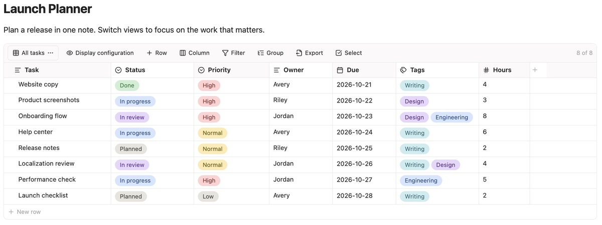

# Super Table

[English](README.md) | [简体中文](README.zh-CN.md)

Super Table 在 Obsidian 笔记中提供可编辑的数据表，支持类型化字段、筛选、排序、分组和多个视图。表格数据与视图配置直接保存在当前 Markdown 笔记中。



## 特色

- **筛选、排序与分组**：用 AND/OR 组合筛选条件，按字段排序、分组，并折叠或展开分组。
- **多个命名视图**：为同一份记录保存多套筛选、排序和分组配置，按需切换。
- **常用字段类型**：文本、链接、数字、日期、复选框、单选、多选和附件。
- **Markdown 与附件**：文本支持格式、列表、内链和可勾选任务；附件列关联文件并显示图片预览。
- **便捷编辑**：调整行列顺序、设置各视图显示的字段、批量复制粘贴记录，并按需获取链接的页面标题。
- **导入导出**：支持导入 Smart Table 和 Markdown 表格，并导出 CSV 或 Markdown。
- **本地保存与双语界面**：表格数据保存在当前笔记中，附件文件保存在 Vault 中，无需账号或插件自有远程服务，不收集遥测。支持英文与简体中文。

## 快速上手

1. **插入表格**：打开一篇笔记，在编辑模式下通过命令面板执行 **Super Table: 插入表格**，或点击侧边栏中的表格按钮。
2. **新增行列与录入**：通过工具栏或右键菜单添加字段和记录，点击单元格录入或编辑数据。
3. **编辑列**：打开列标题菜单，选择 **编辑列**，设置列名、类型及对应的日期格式或选项。
4. **创建并配置视图**：点击工具栏最左侧的当前视图名称，选择 **新建视图**；使用列菜单设置排序，通过 **筛选** 和 **分组** 查看需要的记录。

也可直接输入以下空代码块，在实时预览或阅读视图中显示默认表格：

```super-table
```

实时预览和阅读视图均支持编辑；源码模式显示表格的 JSON 数据。

详细操作、保存规则和兼容说明见[使用指南](docs/USER_GUIDE.zh-CN.md)。也可下载[示例表格](docs/examples/README.md)到 Vault 中体验。

## 使用 AI 编辑

让 AI 修改笔记文件前，先提供 [Super Table 编辑 Skill](SKILL.md)，让它按格式说明编辑并校验数据。Skill 需另行提供给 AI；获取方式和保存注意事项见[使用指南](docs/USER_GUIDE.zh-CN.md#使用-ai-编辑笔记文件)。

## 安装

从 1.0.1 起，需要 Obsidian 1.8.7 或更新版本。

Super Table 尚未收录到社区插件目录，可先手动安装：

1. 从[最新 Release](https://github.com/kingbeyond/obsidian-super-table/releases/latest) 下载 `main.js`、`manifest.json` 和 `styles.css`。
2. 在 Vault 中创建 `.obsidian/plugins/super-table/`，将 `main.js`、`manifest.json` 和 `styles.css` 复制进去。如果 Vault 使用自定义配置目录，请将 `.obsidian` 替换为对应目录名。
3. 重启 Obsidian，打开 **设置 → 第三方插件**，如有需要关闭受限模式，然后启用 **Super Table**。

如需从源码构建，可克隆或下载本仓库，安装 Node.js 后在仓库根目录运行 `npm ci` 和 `npm run build`，再将生成的文件用于第 2 步。

## 网络使用

仅当用户主动点击“获取链接标题”按钮时，插件才会请求该链接对应的网页以读取标题。

## 许可证

Copyright (c) 2026 kingbeyond.

Super Table 采用 [GNU 通用公共许可证第 3 版](LICENSE)，许可标识为 `GPL-3.0-only`。
