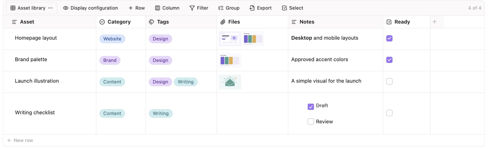
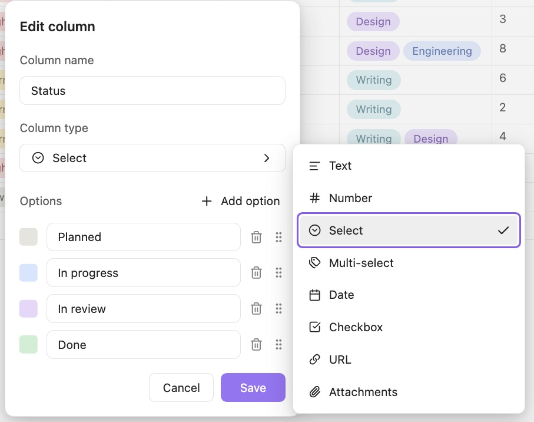
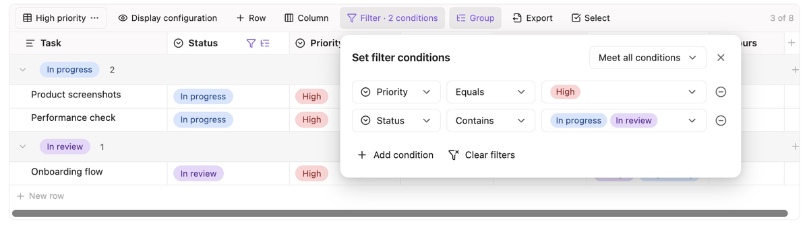

# Super Table 使用指南

[English](USER_GUIDE.md) | [简体中文](USER_GUIDE.zh-CN.md) | [返回 README](../README.zh-CN.md)

可下载[示例表格](examples/README.md)体验。

从 1.0.4 起，需要 Obsidian 1.13.0 或更新版本；1.0.1–1.0.3 的最低要求仍为 Obsidian 1.8.7。

## 创建与查看表格

在笔记编辑模式下执行 **Super Table: 插入表格**，或点击侧边栏中的表格按钮。也可输入空代码块：

```super-table
```

空代码块会显示默认示例表格，首次编辑后保存到笔记中。实时预览和阅读视图均可编辑表格；日常使用无需手写 JSON。

## 单元格编辑

点击单元格选中，再使用对应操作：

| 操作 | 方法 |
| --- | --- |
| 编辑文本或数字 | 再次点击或双击单元格正文，也可选中后按 Enter 或空格。 |
| 打开选项、日期、链接或附件 | 选中后点击对应操作按钮，或按 Enter、空格。 |
| 保存或取消输入 | 点击输入框外保存；按 Escape 取消。Markdown 文本的换行与保存快捷键见下文。 |
| 切换复选框 | 直接点击勾选或取消。 |
| 清空单元格 | 选中单元格后，按 macOS 的 `Delete`（⌫）或 Windows 的 `Backspace` / `Delete`（Del）。 |

清空附件单元格只解除文件关联，不删除 Vault 文件。复制粘贴见[记录与批量操作](#记录与批量操作)。

Super Table 支持撤销和重做操作。

### Markdown 文本

文本单元格支持粗体、斜体、列表及内外链，例如 `[[笔记名称|显示名称]]`。点击链接跳转，点击链接和控件以外的正文进入编辑。

按 Enter 或 `⌘/Ctrl+Enter` 保存，Shift+Enter 换行。可粘贴多行 Markdown，复制单元格会保留原文。

用 `- [ ] 待办` 和 `- [x] 已完成` 创建任务列表，可直接勾选预览中的任务；无法勾选时可编辑原文。

用 `![[图片.png]]` 嵌入图片。笔记、PDF 和音视频的双链嵌入显示为链接，点击后打开。

### 附件



将列类型设为 **附件**，选中单元格后点击右侧下拉按钮打开附件面板。

- **添加 Vault 文件**：点击 **添加附件**，搜索并选择文件，再点击 **添加所选文件**。一个单元格可关联多个文件。
- **从设备导入**：将文件复制到 Obsidian 设置的附件目录。
- **粘贴图片**：复制图片后，选中附件单元格或保持附件面板打开，按 `⌘/Ctrl+V`。

在 **设置 → 第三方插件 → Super Table → 附件图片粘贴位置** 中，可选择遵循 Obsidian 附件设置，或保存到笔记同层的 `附件/<笔记名>/`。此设置只影响粘贴图片。粘贴图片需要剪贴板中的图片数据，仅有图片网址时不会下载。

也可通过设置搜索查找“附件图片粘贴位置”。

点击图片可预览、翻页和缩放；其他附件交由 Obsidian 打开。

附件旁的 `×` 只解除关联，不删除文件。导入或粘贴创建的文件在取消选择或保存失败后也会保留。

链接和附件引用不会随文件重命名或移动自动更新，操作后需检查并重新关联；也不能保证被原生反向链接或关系图谱索引。

### 单选与多选

选中单元格后点击下拉按钮选择选项，再次点击已选项可取消。标签上的 `×` 可移除选项。

通过 **编辑选项…** 改名、选色和删除选项；桌面端可拖动选项行排序。

### 日期与链接

日期和日期时间共用 **日期** 列类型，在 **编辑列** 中设置显示格式。选中单元格后点击日历按钮，可选择或输入日期。

链接单元格可分别设置显示文字和 URL；显示文字留空时使用 URL。点击 **获取链接标题** 会请求该网页并填入标题；需要登录或运行 JavaScript 的页面可能无法获取。

## 字段与列设置



通过工具栏 **新增列** 或表头末尾的 `+` 添加字段。双击列名可改名，右键列标题或打开列菜单可进行更多设置。

选择 **编辑列** 修改类型、日期格式和选项。改为 **附件** 会清空该列原有值；转换若会清除数据或视图筛选，插件会显示影响数量并要求确认。

通过 **显示配置** 拖动字段行调整列顺序，点击眼睛按钮切换当前视图中的可见字段。列顺序由所有视图共享，隐藏状态按视图保存。拖动列边界可调整宽度。

## 记录与批量操作

通过工具栏或表格底部的 **新增行** 添加记录。新记录可能被当前筛选或折叠分组隐藏。

点击行左侧操作柄或右键记录，可插入、复制、移动和删除。未启用排序和分组时，可拖动操作柄调整行顺序。

点击 **选择** 可批量复制、创建副本、删除或导出记录。

| 内容 | 复制与粘贴方法 |
| --- | --- |
| 单元格 | 选中单元格后按 `⌘/Ctrl+C`，选中同类型目标格后按 `⌘/Ctrl+V`，覆盖目标值。 |
| 单行 | 在行菜单复制，再右键目标行选择 **粘贴行**，覆盖整行的值。 |
| 多行 | 选中记录并复制后，通过工具栏 **粘贴 N 行** 添加副本。 |
| 外部文本 | 可粘贴到文本、数字或链接单元格；数字只接受单个有效数值。暂不支持外部多行多列数据的批量粘贴。 |

复制的单元格优先于所选行。用快捷键粘贴单行记录时，会先确认是否替换当前行；粘贴多行请使用 **粘贴 N 行**。复制记录会关联原附件，不会复制文件。

## 视图、筛选、排序与分组

### 管理视图

点击工具栏最左侧的视图名称，可切换、新建、复制或删除视图。

每个视图独立保存筛选、排序、分组和隐藏字段，所有视图共享记录；修改单元格会影响其他视图，删除视图不会删除记录。

插件会在本设备记住上次使用的视图。视图配置随笔记同步，上次使用的视图选择不跨设备同步。

### 表内搜索

点击工具栏 **搜索**，在展开的搜索条中输入文字。搜索只覆盖当前视图筛选后的记录和可见列，折叠分组内的记录也参与搜索；隐藏列和被筛选掉的记录不参与。

- 搜索不区分大小写，按连续文本匹配；同一单元格多次命中只计为一格。结果按当前排序、分组和列顺序导航，不隐藏其他记录。
- 命中单元格整格高亮，当前命中另有强调边框，并自动滚动到可见位置。点击上下箭头或在搜索框按 Enter / Shift+Enter 切换下一个 / 上一个，到末尾循环。
- 文本和链接按保存的原文匹配，包括 Markdown 标记及链接地址；单选、多选按选项名称，附件按文件名和路径，数字按文本值，日期按显示值及完整存储值匹配。不搜索复选框、内部 ID 或附件正文；没有正则与模糊匹配。
- 定位折叠组内的单元格会临时展开对应分组。点击关闭按钮，或在搜索条内按 Esc 退出后，清除高亮并恢复未经手动调整的分组折叠状态。单元格编辑器中的 Esc 仍用于取消编辑。
- 搜索内容不写入笔记，也不修改筛选、排序、字段显隐或导出范围。编辑保存重建表格时保留搜索；切换视图清空关键词，关闭笔记后不保留搜索。Obsidian 原生 ⌘/Ctrl+F 保持原有行为。

### 筛选与排序



点击 **筛选 → 添加条件**，选择字段、运算符和值。顶部选择 **满足全部条件**（AND）或 **满足任一条件**（OR），不支持嵌套条件组；**清除筛选** 移除当前视图的全部条件。

文本、数字和日期填写后按 Enter 或点击其他位置应用；选择选项或切换 AND/OR 会立即应用。

几个容易混淆的条件：

- **等于与包含**：单选“包含”可匹配任一所选选项；多选“等于”要求选项集合完全相同，“包含”匹配任一所选选项，“不包含”表示均未包含。需要同时包含 A、B 时，添加两条“包含”条件并选择 AND。
- **介于**：包含上下限，两端都需要填写。
- **日期**：按日比较，日期时间按分钟比较，仅时间按时分比较；其他显示格式仍使用完整日期。
- **文本与附件**：文本比较 Markdown 原文且忽略大小写；附件“为空”判断有无引用，不检查文件是否存在。

通过列菜单的 **升序排列** 或 **降序排列** 设置排序；两种顺序都会将空值排在末尾。**清除排序** 恢复手动行顺序。每个视图支持一个排序字段。

### 分组

点击 **分组** 选择字段和升降序，点击条件行末的圆圈减号移除分组。点击组标题折叠或展开；每个视图支持一个分组字段，组内遵循当前排序。

多选按选项组合分组：`A + B` 与 `B + A` 属于同一组，每条记录只出现一次。

## 导入与导出

### 导入已有表格

| 来源 | 操作 |
| --- | --- |
| Smart Table | 将光标放在 `smart-table` 代码块内，执行 **Super Table: 导入 Smart Table 代码块**。 |
| Markdown 表格 | 将光标放在 Markdown 表格内，执行 **Super Table: 将 Markdown 表格转换为 Super Table**。 |

核对预览和转换提示后确认，新表会插入原内容下方，保留原始内容。Markdown 数据行若有超出表头的非空单元格，按提示修正后重试。

Smart Table 导入为单向转换，状态列转为单选。若筛选无法完整转换，会清除导入视图的全部筛选并提示，记录仍保留；不保证转换回 Smart Table 后还原配置。

### 导出为 Markdown

点击 **导出 → 导出 Markdown**，可保存文件或复制到剪贴板：

- **当前视图**：可见字段、筛选后的记录及当前排序和分组顺序。
- **全部字段和记录**：所有字段和记录，按保存顺序排列，不受当前视图影响。

附件导出为 Vault 内链，在 Vault 外可能无法打开。

要在笔记中转换，将光标放入 Super Table 代码块，执行 **Super Table: 将 Super Table 表格转换为 Markdown** 并确认预览。默认保留原表并在下方插入结果；勾选 **替换原 Super Table** 会丢失字段类型、选项定义和视图配置。

从 1.0.3 或更早版本升级到 1.0.4 及以后版本时，若为此命令配置过自定义快捷键，请在 Obsidian 快捷键设置中重新绑定。外部命令引用请改用新 ID：`super-table:convert-to-markdown`。

### 导出 CSV

点击 **导出 → 导出 CSV**，范围与 Markdown 相同。行选择模式下的 **导出** 只导出所选记录和当前可见字段。附件值使用 JSON 路径数组，例如 `["附件/截图.png","附件/说明.pdf"]`。

## 界面语言

在 Obsidian 设置中找到 **语言**，选择 English 或简体中文并按提示重启。其他语言暂时回退到英文；已有列名、选项和记录不会被翻译。

## 触屏与宽表浏览

触屏设备可通过行列菜单操作。宽表可横向滚动，也可使用窗格底部的悬浮横向滚动条。

## 使用 AI 编辑笔记文件

让 AI 直接修改表格前，先提供 [Super Table 编辑 Skill](../SKILL.md)，可附上文件、粘贴内容或按 AI 工具的方式安装。安装 Obsidian 插件不会同时将 Skill 安装到 AI 工具。

Skill 提供格式和校验规则；直接修改文件会绕过插件的保存冲突检查，需核对编辑结果。

## 保存、兼容与问题处理

表格数据和视图配置保存在当前笔记中，编辑后自动保存。详细数据格式及兼容规则见 [Skill](../SKILL.md)。

| 问题 | 处理方式 |
| --- | --- |
| 保存冲突 | 其他应用、设备或窗格修改同一表格时，冲突写入会停止。重新加载并核对最新数据后再修改，插件不自动合并。 |
| 格式或单元格值错误 | 编辑会被禁用，原始数据保留。按提示检查源码或原始数据，确认内容后修复。旧版筛选格式不自动迁移。 |
| ID 重复 | 重复的内部 ID 会阻止加载或保存；按提示检查复制的内容，并参照 Skill 核对引用后修复。显示名称相同不等于 ID 重复。 |
